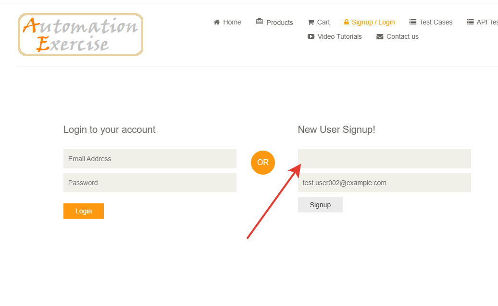
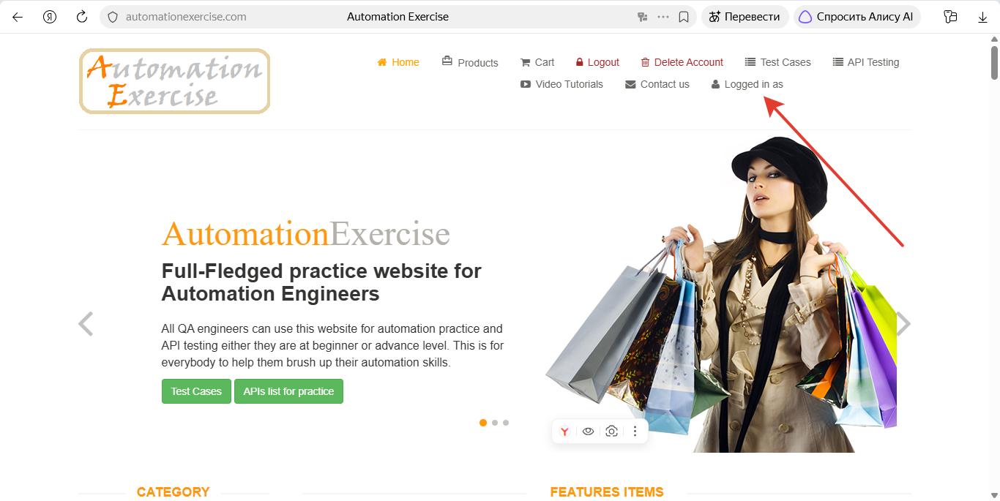

# BUG-001: Поле “Name” при регистрации принимает одни пробелы и создаёт аккаунт без имени

**Серьёзность:** Minor

**Приоритет:** Low

**Воспроизводимость:** Всегда (3 из 3)

**Окружение:** Яндекс Браузер 26.10.0.1854 (64-bit), Windows 11 Pro 25H2, автоперевод страницы отключён

**Предусловие:** Пользователь не авторизован

**Описание:** Поле “Name” принимает значение из одних пробелов, регистрация проходит до конца, а в шапке сайта после входа имя пользователя отсутствует.

**Шаги воспроизведения:**

1. Открыть https://automationexercise.com/login
2. Найти блок “New User Signup!”
3. В поле “Name” ввести три пробела
4. В поле “Email Address” ввести валидный, ещё не зарегистрированный e-mail (например, `test.user.002@example.com`)
5. Нажать “Signup”
6. Заполнить форму “Enter Account Information” и “Address Information” валидными данными
7. Нажать “Create Account”
8. Нажать “Continue” и посмотреть на шапку сайта

**Фактический результат:** Валидация пройдена, аккаунт создан, в шапке сайта после “Logged in as” имя отсутствует.

**Ожидаемый результат:** Показана ошибка, регистрация не продолжается.

**Связанный дефект:** [BUG-002](BUG-002.md)

**Примечание:** Требований к полю “Name” на сайте нет, сайт учебный, ожидание основано на общепринятой практике.

**Скриншоты:**

