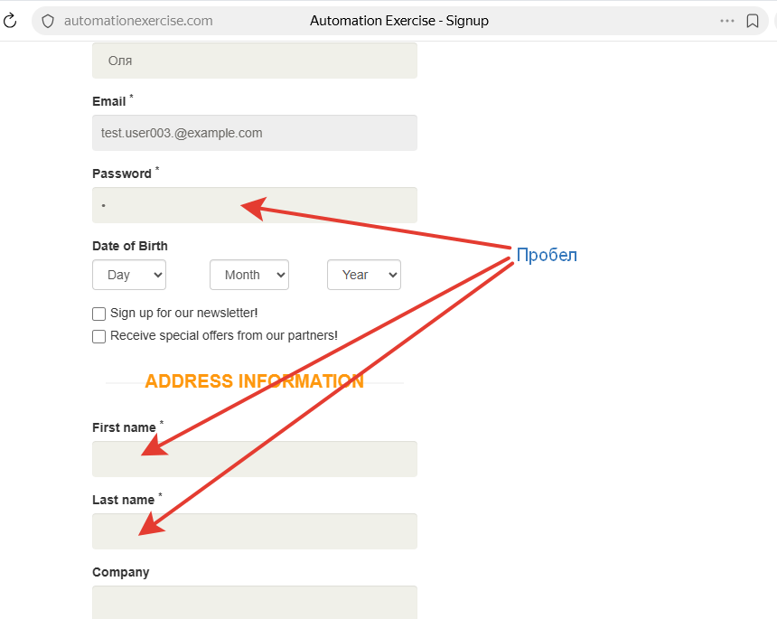
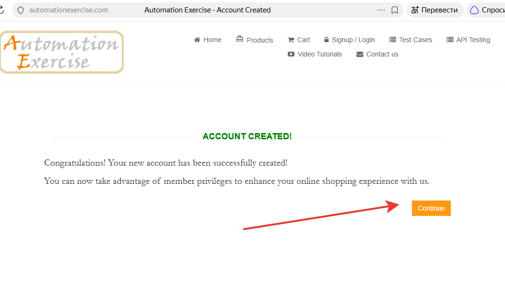

# BUG-001: Обязательные поля формы регистрации принимают значения из одних пробелов, аккаунт создаётся с пустыми данными.

**Описание**

При заполнении формы регистрации. Форма не проверяет содержимое обязательных полей, значения из одних пробелов принимаются, аккаунт создаётся. 

**Предусловие**:

Пользователь не авторизован, e-mail не зарегистрирован.

**Шаги воспроизведения**:

1.Открыть https://automationexercise.com/signup

2.В блоке  New User Signup! ввести валидные “Name” и “E-mail”, нажать “Signup”

3.В формах “Enter Account Information” и “Address Information” ввести в поля по одному пробелу 

4.Нажать “Create Account”

5.В приветственном окне нажать «Continue» 

**Фактический результат**:

Пользователь получает приветствующее сообщение, аккаунт создан.

**Ожидаемый результат**:

Показана ошибка, регистрация не продолжается, обязательное поле не может состоять из одних пробелов.

**Серьезность**:  Minor

**Приоритет**: Low

**Окружение**: Яндекс Браузер 26.10.0.1854 (64-bit), Windows 11 Pro 25H2

**Примечание**: 
Требования к полям на сайте нет, ожидания основаны на общепринятой практике, аналогичный результат при вводе двух и трех пробелов.

**Скриншот**:

